  <a href="https://percivalmahwaya.github.io">Portfolio</a> ·
  <a href="https://linkedin.com/in/percivalmahwaya">LinkedIn</a> ·
  <a href="https://percivalmahwaya.github.io/contact.html">Contact</a> ·
  <a href="https://github.com/percivalmahwaya?tab=repositories">Repositories</a>

  

  

I build systems which run, then publish how well they run. More than half a decade of law-enforcement IT in Zimbabwe taught me that a wrong record leads to a wrong action. The animations above are a knight's tour and a real King+Bishop+Knight checkmate, for the chess software - both computed and verified, not hand-typed.

### `$ cat topics.txt`

- Judging a forecast: held-out seasons, models built to show where they lose
- Scheduled pipelines which retrain and publish without me
- Release checks run against the deployed system

### `$ ls skills/`

- Data: Python, SQL, scikit-learn. [model.py](https://github.com/percivalmahwaya/fpl-decision-engine/blob/main/model.py), [qa.py](https://github.com/percivalmahwaya/fpl-decision-engine/blob/main/qa.py), [migrate.py](https://github.com/percivalmahwaya/fpl-decision-engine/blob/main/migrate.py)
- DevOps: GitHub Actions, scheduled pipelines, deploy checks. [fpl.yml](https://github.com/percivalmahwaya/fpl-decision-engine/blob/main/.github/workflows/fpl.yml), [qa_deploy.py](https://github.com/percivalmahwaya/fpl-decision-engine/blob/main/qa_deploy.py)
- Web: Django, PostgreSQL, payments. [bcaChessHub](https://github.com/percivalmahwaya/bcachesshub), [middleware.py](https://github.com/percivalmahwaya/bcachesshub/blob/master/members/middleware.py)
- Dashboards: Streamlit. [app.py](https://github.com/percivalmahwaya/crime-hotspot-dss/blob/master/app.py)

Still learning: Docker, Terraform and Kubernetes. No public proof yet.

### `$ ls work/`

- [FPL Decision Engine](https://github.com/percivalmahwaya/fpl-decision-engine) · [live](https://percivalmahwaya.github.io/fpl-decision-engine/). Retrains and republishes every three hours. 77 test functions.
- [Bulawayo Chess Hub](https://github.com/percivalmahwaya/bcachesshub) · [live](https://web-production-abe9b.up.railway.app). Chess tournaments, Elo and payments. 260 test functions.
- [Crime Hotspot DSS](https://github.com/percivalmahwaya/crime-hotspot-dss) · [live](https://crime-hotspot-dss-8d2jrkagpvgsegqp6y23d4.streamlit.app/). My MSc thesis. AUC-ROC 0.966. The free host sleeps and wakes in about a minute.

### `$ git log --oneline`

Updated by a workflow. The workflow fails if a source returns nothing.

<!-- latest:start -->
FPL Decision Engine scoreboard, gameweek 9: model error (MAE) 0.920 against 1.015 and 1.075 for the two baselines. Lower is better. It loses on high-return players: 4.835 against 4.054 and 4.117. Only 6 gameweeks are scored.

FPL pipeline: the last completed run succeeded on 2026-11-08 07:03 UTC.

Recent commits:

- 2026-11-07 [fpl-decision-engine](https://github.com/percivalmahwaya/fpl-decision-engine/commit/6d700b3852752fe7de5133e89dc3715561852bf8): Fix recurring GW-finished race: QA and backfill now read one shared signal
- 2026-10-11 [percivalmahwaya.github.io](https://github.com/percivalmahwaya/percivalmahwaya.github.io/commit/283eda2791d2b06acdb4b62ed52b8092bbe9671e): add .nojekyll: a Liquid tag in an ADR was hanging the Pages build
- 2026-10-11 [percivalmahwaya.github.io](https://github.com/percivalmahwaya/percivalmahwaya.github.io/commit/9cbf1af793afe152380a3a8551341762b352985a): correct a wrong "not live" call, and the stale memory behind it
- 2026-10-11 [percivalmahwaya.github.io](https://github.com/percivalmahwaya/percivalmahwaya.github.io/commit/617ca1ed592eb1816241cc4ea000f5024397c612): redesign the site: dark/light editorial rebuild, spec-first
- 2026-10-10 [percivalmahwaya.github.io](https://github.com/percivalmahwaya/percivalmahwaya.github.io/commit/d2a9b54d2919474ae64fa8874e348b29468439d6): add bcaChessHub, Progeny FPL engine, OSP Scout, and chess economics research ...

Refreshed 2026-11-08 08:08 UTC by tools/refresh.py.
<!-- latest:end -->

  <a href="https://percivalmahwaya.github.io/contact.html"><code>$ echo "open to data, DevOps and research roles"</code></a>
   
  Katowice, Poland. Open to Ireland and Australia.

